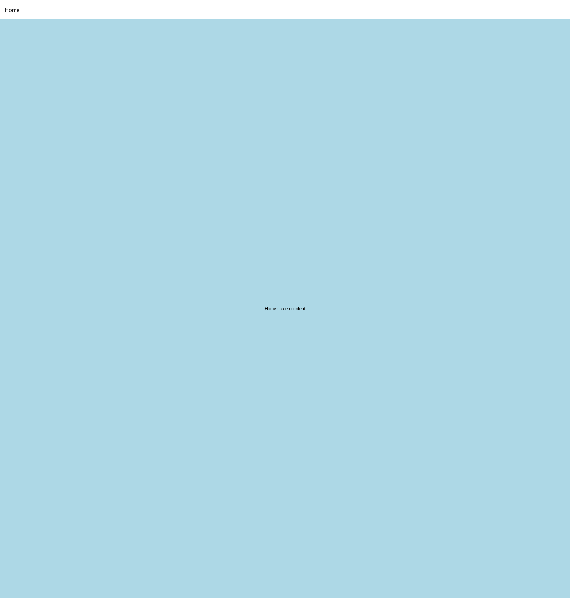

# react-native-screens: web `Screen` drops `style` when `enabled={false}`

Minimal reproduction for a react-native-screens bug on web: a `@react-navigation/stack`
navigator with `detachInactiveScreens={false}` renders its screens collapsed to their content
height instead of filling the navigator.

## Run

```bash
npm install
npx expo start --web
```

- http://localhost:8081/ uses `detachInactiveScreens={false}`: the light blue screen is one line
  of text high.
- http://localhost:8081/?detach=true uses `detachInactiveScreens={true}`: the screen fills the
  area below the header.

| `detachInactiveScreens={false}` | `detachInactiveScreens={true}` |
|---|---|
|  |  |

## Cause

`src/components/Screen.web.tsx` destructures `style` from the props and only passes it on in the
`enabled` branch:

```tsx
let { active, activityState, style, enabled = screensEnabled(), ...rest } = this.props;
if (enabled) {
  // ...
  return <View hidden={...} style={[style, { display: ... }]} {...rest} />;
}
return <View {...rest} />; // style is lost
```

`@react-navigation/stack` renders every card inside `<Screen enabled={detachInactiveScreens}
style={StyleSheet.absoluteFill} ...>`, so without detaching the wrapper loses `absoluteFill` and
becomes a normal, content-sized view. The card inside is absolutely positioned and ends up in a
zero-height box.

The native fallback in `src/components/Screen.tsx` keeps `style`. Passing it through on web
(`return <View style={style} {...rest} />;`) fixes the reproduction.
